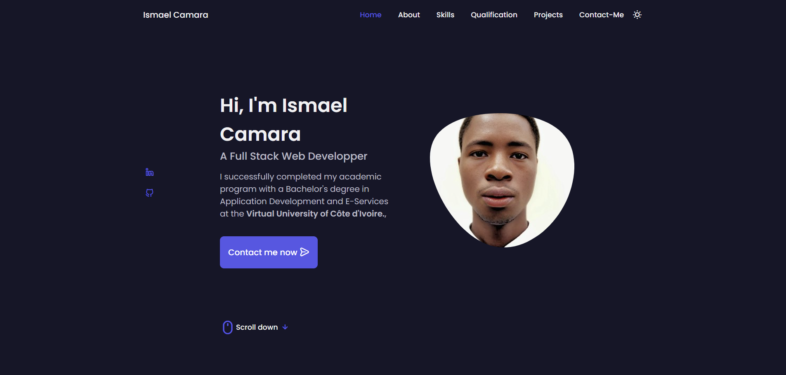

# Portfolio — Ismael Camara (leCoderon)

Portfolio de développeur full stack IA : profil, compétences, parcours et projets en une seule page.


## Aperçu

Site portfolio personnel de **Ismael Camara**, développeur full stack IA basé à Abidjan (Côte d'Ivoire). Il regroupe en une page son positionnement professionnel, ses compétences, son parcours et ses réalisations. Il s'adresse aux recruteurs, clients et partenaires qui veulent évaluer rapidement son profil, consulter ses justificatifs et le contacter. Le site est construit en HTML, CSS et JavaScript vanilla : aucun framework, aucune étape de compilation.

## Fonctionnalités

- Cerner mon profil et mon positionnement de développeur full stack IA dès l'accueil.
- Télécharger mon CV en PDF en un clic.
- Parcourir mes compétences par catégories, avec l'IA et l'automatisation mises en avant.
- Suivre mon parcours et ouvrir chaque justificatif (diplômes, prix, certificats) depuis la timeline.
- Explorer mes projets dans un carrousel, avec le dépôt GitHub et la démo de chacun.
- Me contacter en un clic : WhatsApp, email ou formulaire.
- Choisir entre thème clair et sombre, mémorisé à la prochaine visite.
- Consulter le site confortablement sur mobile, tablette et desktop.

## Technologies

| Élément | Choix |
|---|---|
| Structure | HTML5 sémantique, page unique |
| Styles | CSS3 vanilla — design system en variables `:root` |
| Scripts | JavaScript vanilla, sans framework |
| Carrousel | Swiper 6, embarqué localement |
| Icônes | Unicons 4 (CDN) |
| Polices | Google Fonts — Poppins (texte) + Space Grotesk (titres) |
| Formulaire | Formspree, avec repli WhatsApp |
| Hébergement | GitHub Pages |

## Structure du projet

```
My-personal-portfolio/
├── index.html                  # Page unique : toutes les sections
├── preview.png                 # Image d'aperçu du site
├── CV_Ismael_Camara_Developpeur_FullStack_IA.pdf   # CV téléchargeable
├── README.md
└── assets/
    ├── newcss.css              # Design system complet (palette, composants, responsive)
    ├── ptj.js                  # Interactions (menu, accordéon, onglets, modales, thème, formulaire)
    ├── swiper-bundle.min.css   # Swiper 6 — styles
    ├── swiper-bundle.min.js    # Swiper 6 — script
    ├── documents/              # Justificatifs PDF (certificat, diplômes, prix)
    └── img/
        ├── photo-profil.jpg    # Photo de profil
        ├── project-*.jpg       # Captures des projets du carrousel
        └── favicon.svg         # Favicon
```

- `index.html` — toutes les sections du site : accueil, à propos, compétences, parcours, projets, contact et pied de page.
- `assets/newcss.css` — le design system : palette en variables, typographie, composants (boutons, cartes, timeline), responsive et thème sombre.
- `assets/ptj.js` — les comportements : menu mobile, accordéon des compétences, onglets du parcours, modales, carrousel, thème et formulaire.
- `assets/documents/` — les justificatifs téléchargeables, nommés au format `Type_Mots_En_PascalCase.pdf`.
- `assets/img/` — les visuels : photo de profil, captures des projets et favicon.

## Installation & lancement

**Prérequis :** aucun. Un navigateur suffit pour consulter le site.

1. Cloner le dépôt :

   ```bash
   git clone https://github.com/leCoderon/My-personal-portfolio.git
   cd My-personal-portfolio
   ```

2. Ouvrir le site directement :

   ```bash
   # Windows
   start index.html
   ```

3. Ou le servir localement, ce qui est recommandé pour tester le formulaire :

   ```bash
   python -m http.server 8000
   ```

4. Ouvrir <http://localhost:8000> dans le navigateur.

## Configuration

Aucune variable d'environnement n'est nécessaire : le site est statique et aucun secret n'est stocké dans le dépôt.

Le formulaire de contact s'appuie sur [Formspree](https://formspree.io/) pour envoyer les messages sans backend :

1. Créer un formulaire gratuit sur Formspree.
2. Remplacer `VOTRE_ID` dans l'attribut `action` du formulaire `#contact-form` (`index.html`) par l'identifiant fourni, de la forme `https://formspree.io/f/xxxxxxx`.

Tant que l'identifiant n'est pas renseigné, l'envoi bascule automatiquement sur **WhatsApp** avec un message pré-rempli (nom, email et message du visiteur).

## Utilisation

- **Navigation** — les liens du menu défilent vers chaque section et le lien actif suit le défilement.
- **Compétences** — les 4 catégories restent dépliées sur grand écran (≥ 768 px) ; sur mobile, l'accordéon n'en ouvre qu'une à la fois.
- **Parcours** — les onglets *Formation* et *Distinctions* basculent la timeline ; chaque entrée ouvre son justificatif PDF.
- **Projets** — carrousel navigable aux flèches et aux puces ; chaque projet renvoie au dépôt GitHub et à la démo.
- **Thème** — le bouton de l'en-tête bascule clair/sombre et mémorise le choix dans `localStorage`.
- **Personnalisation** — la couleur d'accent se règle via `--hue-color` dans `:root` (`assets/newcss.css`) ; les textes, projets et coordonnées s'éditent dans `index.html`.
- **Déploiement** — publier le dossier tel quel sur GitHub Pages, Netlify ou Vercel : aucune compilation n'est requise.

## Captures d'écran



[Ajouter ici des captures des sections Compétences, Parcours et Projets.]

## Roadmap

- [ ] Renseigner l'identifiant Formspree pour activer l'envoi natif du formulaire.
- [ ] Ajouter une version anglaise du site.
- [ ] Créer une page détaillée par projet (contexte, stack, captures).
- [ ] Convertir les images en WebP pour alléger le chargement.
- [ ] Ajouter un mode impression optimisé pour le CV.
- [ ] Publier des notes techniques depuis le portfolio.

## Contribuer

Ce dépôt est un portfolio personnel : les contributions externes ne sont pas attendues, mais les remarques et signalements sont bienvenus.

1. *Fork* le dépôt.
2. Créer une branche dédiée : `git checkout -b fix/nom-du-correctif`.
3. Committer les changements : `git commit -m "Corrige ..."`.
4. Pousser la branche puis ouvrir une *pull request*.

## Licence

[À compléter] — aucun fichier `LICENSE` n'est présent dans le dépôt. Ajouter un fichier `LICENSE` (MIT par exemple) puis mettre cette section à jour.

## Contact

- **Ismael Camara** — pseudonyme **leCoderon**
- Email : <camara9ismael@gmail.com>
- Téléphone / WhatsApp : [+225 05 84 78 45 81](https://wa.me/2250584784581)
- GitHub : <https://github.com/leCoderon>
- LinkedIn : <https://www.linkedin.com/in/isma%C3%ABl-camara-stage-developpeur-laravel-php-fullstack-developper-backend-frontent-abidjan/>
- Portfolio en ligne : <https://lecoderon.github.io/My-personal-portfolio/>
